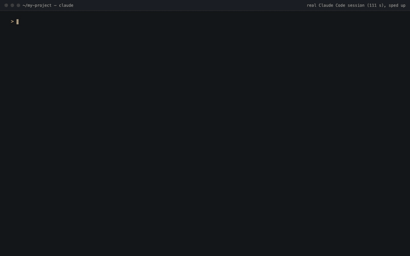

# rcm-doctor

[](https://github.com/nicoladelbene/rcm-doctor/actions/workflows/ci.yml)

**An open-source reviewer for Risk & Control Matrices (internal controls / IKS / SOX).**
It reviews each control the way a senior controls reviewer would. Every finding cites the exact text behind it, and the tool is evaluated against ground truth.


### Try it in 30 seconds → **[https://rcm-doctor.vercel.app](https://rcm-doctor.vercel.app/?demo)**


The demo needs no API key: it opens a synthetic 40-control RCM with precomputed results.

---

## Why

Risk & Control Matrices are the backbone of every internal control system. For Swiss companies under ordinary audit, the auditor confirms that an internal control system (IKS) exists (Art. 728a OR). In practice RCMs are full of controls that are hard to test and hard to automate. Typical problems:

- no clear owner, or a person's name instead of a role
- vague verbs: *"Finance ensures invoices are correct"*
- no trigger or timing, and a frequency that contradicts the frequency column
- no evidence defined, and no precision threshold for review controls
- the same role preparing and approving

rcm-doctor finds these problems, shows where they are in the text and proposes a rewrite.

## What it checks

**Six design attributes** (AI review, each with a cited span or flagged as missing):

| | Attribute | Passes when… |
|---|---|---|
| 1 | **Who** | the performer is a *role*, not a person or a department |
| 2 | **What** | there is a concrete action: review, reconcile, compare, approve, block |
| 3 | **When** | there is a timing or trigger: "within 3 business days after month-end", "before payment release" |
| 4 | **Frequency** | the frequency is stated and plausible for the risk |
| 5 | **Evidence** | the text says what is retained and where |
| 6 | **Precision** | review controls have a threshold or investigation criterion ("> CHF 10k or 5%") |

**Six consistency rules** (deterministic, no AI): frequency in the description vs. the frequency column · *automated* controls that describe manual steps · owner empty or a person's name · segregation-of-duties conflict ("prepares and approves") · missing risk ID or control objective · key control without evidence.

**Per control:** status (pass / weak / fail), findings with severity, an **automation score** from 0 (pure judgment) to 5 (system-enforceable, ITAC candidate), and a **suggested rewrite** that invents nothing material. Missing facts become `[placeholders]`.

**Test scripts (Week 2):** for each control, a test of design (walkthrough steps) and a test of operating effectiveness. The sample size comes from the frequency (illustrative minimums you can configure). Each test attribute carries its procedure and evidence, and points to the phrase of the control it tests. Controls with high-severity design findings are marked "remediate first" instead of being tested. Everything is included in the Excel export.

**Evidence tester (Week 3):** upload the evidence for a control (PDF, screenshot or CSV) and the agent ticks & ties every sampled item against every test attribute: ✓ met, ✗ exception, ? not evidenced, – not applicable. Each result draws a box on the PDF page or screenshot, or outlines the CSV cell, where the proof is, and points back to the phrase of the control description the attribute tests. A box is drawn only where code found the quoted text in the evidence. The conclusion (no exceptions / exceptions / incomplete) is computed from the results, not by the model. PDFs and CSVs are read in the browser (pdf.js); screenshots are transcribed by the vision model, so their boxes are marked approximate. The demo ships synthetic evidence for 5 controls, two of them with planted exceptions.

**Automation opportunities (Week 4):** a process × control-type heatmap of the automation score, and for each control scoring ≥ 4 a business case: hours saved per year from the frequency, ITAC or RPA/script (with the words that justify it cited), prerequisites, payback, and "remediate the design first" where needed. Every assumption (minutes per run, volumes, share removed, hourly rate, build effort) is on screen, editable, and exported. No extra AI call.

**Traceability:** the model quotes the text, and code locates the quote in your RCM. A quote that cannot be found is dropped, never shown. The Excel export records each cited span with its field and character offsets.

## Evaluation

All runs use the default model (`anthropic/claude-sonnet-5.5`). Recall = labelled defects found; FP = clean controls with at least one finding.

| Set | System | Controls | Defects | Recall | FP on clean | Precision |
|---|---|---:|---:|---:|---:|---:|
| **Demo** (authored with the prompt; regression test) | Week 1.1 (`review.v2`) | 40 EN | 33 | **100%** (33/33) | **4%** (1/25) | 85% |
| **Holdout v1** — gpt-5.6-sol, first measurement | Week 1 (`review.v1`) | 30 (10 DE) | 28 | 82% (23/28) | 17% (2/12) | 82% |
| **Holdout v2** — gemini-4-argon, never seen | Week 1 (baseline) | 30 (10 DE) | 63 | 86% (54/63) | 58% (7/12) | 76% |
| **Holdout v2** — gemini-4-argon, never seen | **Week 1.1** (`review.v2`) | 30 (10 DE) | 63 | **92%** (58/63) | **25%** (3/12) | 84% |

By language:

| | Holdout v1 · Week 1 | Holdout v2 · Week 1 | Holdout v2 · Week 1.1 |
|---|---|---|---|
| English: recall / FP on clean | 89% / 0% (0/8) | 88% / 43% (3/7) | 90% / 43% (3/7) |
| German: recall / FP on clean | 70% / 50% (2/4) | 81% / 80% (4/5) | **95% / 0%** (0/5) |

Other models on the demo set: Haiku 5.5 reaches 82% recall with 4% false positives (~USD 0.04 per 40 controls, vs ~USD 0.41 for Sonnet). Rules alone reach 39% recall with 0% false positives.
**Evidence tester (Week 3):** on 5 synthetic evidence packs (163 sampled item × attribute checks, 3 planted exceptions plus deliberate near-misses such as an amount exactly at a threshold or a weekend inside a 2-business-day deadline), Sonnet 5.5 found **3/3** exceptions with the box on the proving text, raised **0** false exceptions on 160 clean checks, and tied **100%** of its ticks and exceptions to a verified box or cell. Same caveat as the demo set: evidence and prompt come from one author, so it is a regression test, not a benchmark. Report: [`docs/eval-evidence.md`](docs/eval-evidence.md).

Reports: [`docs/eval-latest.md`](docs/eval-latest.md) · [`docs/eval-holdout.md`](docs/eval-holdout.md) · [`docs/eval-evidence.md`](docs/eval-evidence.md) · [`docs/eval-models.md`](docs/eval-models.md). Reproduce offline: `npm run eval` (demo + evidence) and `npm run eval:holdout`. All run in CI.
**Methodology:** for each holdout, a non-Claude model generated 30 controls for a new fictional Swiss company (10 in German, Swiss IKS terms) and labelled the defects in the same call. The labels were committed before any review. The reviewer was frozen first, with SHA-256 hashes in `data/holdout*/`. Labels are the generator's and were not edited, so the numbers include the generator's own label noise. Holdout v2 was generated *after* the Week 1.1 fixes were frozen. Its rejected attempts and the one post-freeze change are listed in [`data/holdout-v2/GENERATION-LOG.md`](data/holdout-v2/GENERATION-LOG.md).

### Changelog (honest version)
- **Week 1.1** (Nov 15): German rules (`Leiter …` / `…verantwortliche` are roles, German departments are flagged, `manuell` is recognised), more segregation-of-duties phrasings, and SoD assessed by the AI as well (prompt `review.v2`).
  - **German on unseen data:** false positives on clean German controls went from 80% to 0%, and German recall from 81% to 95% (holdout v2, same model, same day).
  - **Not fixed:** English false positives on holdout v2 are still 43% (3/7 clean controls), mostly a strict "frequency"/"when" reading. Frequency-mismatch catches 1 of 3 cases.
  - **Demo:** one new false positive (1/25), which was 0/25 with v1.
- Holdout v1 re-run with Week 1.1 scores 100% / 0%, but that set was **seen** while writing the fixes, so it is not evidence and is not in the table ([report](docs/eval-holdout-v1-rerun.md)).
- **Transport fix after the freeze:** the token budget was raised and truncated answers are now reported as such, because Sonnet 5.5 reasoning tokens truncated long German batches. The prompt and rules were not changed.
- **Week 1** (Nov 15): first release; holdout v1 measured once with the frozen `review.v1`.

Other models on the demo set (`review.v1`): Haiku 5.5 reaches 82% recall with 4% false positives (~USD 0.04 per 40 controls, vs ~USD 0.41 for Sonnet). Rules alone reach 39% recall with 0% false positives.
Reports: [`docs/eval-latest.md`](docs/eval-latest.md) · [`docs/eval-holdout.md`](docs/eval-holdout.md) (v1) · [`docs/eval-holdout-v2.md`](docs/eval-holdout-v2.md) · [`docs/eval-holdout-v2-baseline.md`](docs/eval-holdout-v2-baseline.md) · [`docs/eval-models.md`](docs/eval-models.md). Reproduce offline: `npm run eval`, `npm run eval:holdout`, `npm run eval:holdout2`. All run in CI.

## Use your own RCM

1. Click **Upload your RCM** and drop an `.xlsx` or `.csv` file. Common header variants are mapped automatically ("Owner", "Control activity", "Periodicity" …), and you confirm the mapping. You can also start from the [template](public/rcm-template.xlsx).
2. **No key:** the six consistency rules run instantly in your browser.
3. **With an [OpenRouter](https://openrouter.ai/keys) key:** you also get the six attributes, the automation score and the rewrite. Pick any model.
4. **Download report (.xlsx):** your original columns plus status, findings, cited text, automation score and rewrite.

**Privacy:** files are parsed in your browser. For the AI review, controls are sent in batches to this app's `/api/review` endpoint, which forwards them to OpenRouter with your key. The key is never logged or stored, and results are cached only in your browser's localStorage. Even so, use synthetic or anonymised data.

## Use it inside Claude (MCP server + skill)

rcm-doctor ships an [MCP](https://modelcontextprotocol.io) server (stdio) with two tools, built on the same `src/core` as the web app:

| Tool | What it does |
|---|---|
| `review_rcm` | Design review per control: pass / weak / fail, findings that each cite the exact source text, automation score, suggested rewrite. |
| `generate_test_scripts` | Test of design + test of operating effectiveness: sample size by frequency, population, test attributes traced to the text, "remediate first" blockers. |

Input: `path` to an .xlsx/.xls/.csv RCM, `csv` text, or `source: "demo"` (the synthetic 40-control RCM, no key needed). Optional `control_ids`.
Without `OPENROUTER_API_KEY` in the server's environment it runs the deterministic rules (or the precomputed demo); with it, the full AI review. The key stays in your config: it is never logged or returned by a tool.



**Claude Code**

```bash
claude mcp add rcm-doctor -- npx -y github:nicoladelbene/rcm-doctor
# optional, for the AI step:
claude mcp add rcm-doctor -e OPENROUTER_API_KEY=sk-or-... -- npx -y github:nicoladelbene/rcm-doctor
```

**Claude Desktop** — Settings → Developer → Edit config (`claude_desktop_config.json`), then restart:

```json
{
  "mcpServers": {
    "rcm-doctor": {
      "command": "npx",
      "args": ["-y", "github:nicoladelbene/rcm-doctor"],
      "env": { "OPENROUTER_API_KEY": "sk-or-... (optional)" }
    }
  }
}
```

From a clone (faster start, no download): `npm ci`, then use `"command": "node", "args": ["/path/to/rcm-doctor/mcp/dist/rcm-doctor-mcp.mjs"]`, or `npm run mcp` to run it from source.

**Skill** — [`skills/rcm-doctor/SKILL.md`](skills/rcm-doctor/SKILL.md) tells Claude when to use the tools and how to present results (quote the cited text, never invent a finding, say which mode ran).
Claude Code: copy the folder to `~/.claude/skills/rcm-doctor/` (or `.claude/skills/` in a project). Claude apps: zip the `rcm-doctor` folder and upload it under Settings → Capabilities → Skills.

Then ask: *"Review the Treasury controls in my RCM (~/Documents/my-rcm.xlsx). What should I fix first?"* — or *"Show me rcm-doctor on the demo RCM"*.

## Run locally

```bash
git clone https://github.com/nicoladelbene/rcm-doctor && cd rcm-doctor
npm install
npm run dev                      # http://localhost:3000

npm test                         # unit tests (vitest)
npm run eval                     # eval against the committed demo results
OPENROUTER_API_KEY=... npm run eval -- --live --model anthropic/claude-haiku-5.5
npm run test:e2e                 # Playwright end-to-end
npm run gen:demo                 # regenerate the synthetic RCM + ground truth
OPENROUTER_API_KEY=... npm run precompute   # regenerate demo results
```

Layout: the review logic is plain TypeScript in [`src/core`](src/core) (parse, rules, LLM, review, export, eval) with no framework imports, so it can become a CLI, a Claude skill or an MCP server. The Next.js UI lives in [`src/app`](src/app). The prompt is versioned in [`src/core/prompts/review.v1.md`](src/core/prompts/review.v1.md). Decisions are recorded as ADRs in [`docs/decisions`](docs/decisions).

## Roadmap

One increment per weekend ([full roadmap](docs/ROADMAP.md)):

- **Week 1:** RCM review, demo mode, Excel export, eval ✅
- **Week 2:** test-script generator (test of design + operating effectiveness, sample sizes by frequency) ✅
- **Week 3:** evidence tester: tick & tie each attribute to uploaded evidence, with boxes on the source (built on branch `week-3`)
- **Week 4:** automation-opportunity heatmap and business case per control (built on branch `week-4`)
- **Week 5:** MCP server + Claude skill (built on branch `week-5`)
- **Week 6:** AI-governance control pack (EU AI Act / ISO 42001 / FINMA expectations)

## Disclaimer

Personal project by Nicola Del Bene. Views are my own; not affiliated with or endorsed by any employer. All demo data is synthetic: *Alpenfirn Industries AG* is a fictional company. This is a design-review aid, not audit advice.

## License

[Apache-2.0](LICENSE)
