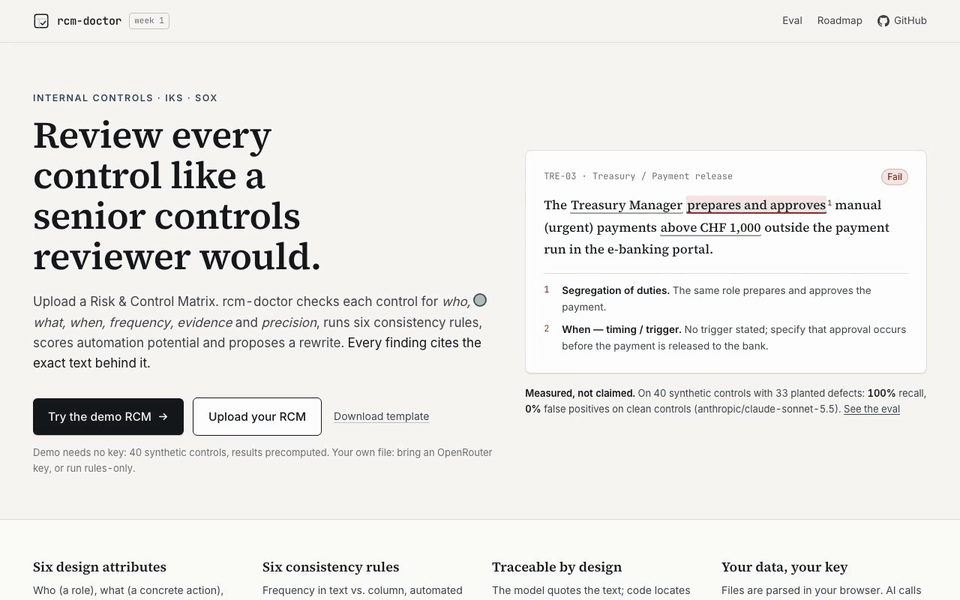

# rcm-doctor

[](https://github.com/nicoladelbene/rcm-doctor/actions/workflows/ci.yml)

**An open-source reviewer for Risk & Control Matrices (internal controls / IKS / SOX).**
It reviews each control the way a senior controls reviewer would. Every finding cites the exact text behind it, and the tool is evaluated against ground truth.



### Try it in 30 seconds → **[https://rcm-doctor.vercel.app](https://rcm-doctor.vercel.app/?demo)**

The demo needs no API key: it opens a synthetic 40-control RCM with precomputed results.

---

## Why

Risk & Control Matrices are the backbone of every internal control system. For Swiss companies under ordinary audit, the auditor confirms that an internal control system (IKS) exists (Art. 728a OR). In practice RCMs are full of controls that are hard to test and hard to automate. Typical problems:

- no clear owner, or a person's name instead of a role
- vague verbs: *"Finance ensures invoices are correct"*
- no trigger or timing, and a frequency that contradicts the frequency column
- no evidence defined, and no precision threshold for review controls
- the same role preparing and approving

rcm-doctor finds these problems, shows where they are in the text and proposes a rewrite.

## What it checks

**Six design attributes** (AI review, each with a cited span or flagged as missing):

| | Attribute | Passes when… |
|---|---|---|
| 1 | **Who** | the performer is a *role*, not a person or a department |
| 2 | **What** | there is a concrete action: review, reconcile, compare, approve, block |
| 3 | **When** | there is a timing or trigger: "within 3 business days after month-end", "before payment release" |
| 4 | **Frequency** | the frequency is stated and plausible for the risk |
| 5 | **Evidence** | the text says what is retained and where |
| 6 | **Precision** | review controls have a threshold or investigation criterion ("> CHF 10k or 5%") |

**Six consistency rules** (deterministic, no AI): frequency in the description vs. the frequency column · *automated* controls that describe manual steps · owner empty or a person's name · segregation-of-duties conflict ("prepares and approves") · missing risk ID or control objective · key control without evidence.

**Per control:** status (pass / weak / fail), findings with severity, an **automation score** from 0 (pure judgment) to 5 (system-enforceable, ITAC candidate), and a **suggested rewrite** that invents nothing material. Missing facts become `[placeholders]`.

**Test scripts (Week 2):** for each control, a test of design (walkthrough steps) and a test of operating effectiveness. The sample size comes from the frequency (illustrative minimums you can configure). Each test attribute carries its procedure and evidence, and points to the phrase of the control it tests. Controls with high-severity design findings are marked "remediate first" instead of being tested. Everything is included in the Excel export.

**Automation opportunities (Week 4):** a process × control-type heatmap of the automation score, and for each control scoring ≥ 4 a business case: hours saved per year from the frequency, ITAC or RPA/script (with the words that justify it cited), prerequisites, payback, and "remediate the design first" where needed. Every assumption (minutes per run, volumes, share removed, hourly rate, build effort) is on screen, editable, and exported. No extra AI call.

**Traceability:** the model quotes the text, and code locates the quote in your RCM. A quote that cannot be found is dropped, never shown. The Excel export records each cited span with its field and character offsets.

## Evaluation

Two synthetic sets, both reviewed with the default model (`anthropic/claude-sonnet-5.5`) and prompt `review.v1`:

| Set | Controls | Labelled defects | Recall | False positives on clean controls | Precision |
|---|---:|---:|---:|---:|---:|
| **Demo** (authored with the prompt; regression test) | 40 (EN) | 33 | **100%** (33/33) | **0%** (0/25) | 89% |
| **Holdout** (independent, see below) | 30 | 28 | **82%** (23/28) | **17%** (2/12) | 82% |
| ↳ English | 20 | 18 | 89% (16/18) | 0% (0/8) | 94% |
| ↳ German (Swiss IKS terminology) | 10 | 10 | 70% (7/10) | 50% (2/4) | 64% |

**Holdout methodology:** `openai/gpt-5.6-sol` (a non-Claude model) generated 30 controls for a different fictional company, 10 of them in German, and labelled their defects in the same call. The labels were committed before any review ran, the review prompt was frozen (its SHA-256 is in `data/holdout/`), and nothing was tuned afterwards, so the numbers include the generator's own label noise.

**Known limits shown by the holdout:** the six AI attribute checks found all 15 labelled attribute defects. All 5 misses come from the deterministic rules. The owner and nature rules are English-only: they treat German roles such as "Leiter Kreditorenbuchhaltung" as person names (4 false positives) and miss German departments and "manuell". The segregation-of-duties pattern misses phrasings like "prepares … and then approves the same reconciliation". These will be fixed and then measured on a *new* holdout.

Other models on the demo set: Haiku 5.5 reaches 82% recall with 4% false positives (~USD 0.04 per 40 controls, vs ~USD 0.41 for Sonnet). Rules alone reach 39% recall with 0% false positives.
Reports: [`docs/eval-latest.md`](docs/eval-latest.md) · [`docs/eval-holdout.md`](docs/eval-holdout.md) · [`docs/eval-models.md`](docs/eval-models.md). Reproduce offline: `npm run eval` and `npm run eval:holdout`. Both run in CI.

## Use your own RCM

1. Click **Upload your RCM** and drop an `.xlsx` or `.csv` file. Common header variants are mapped automatically ("Owner", "Control activity", "Periodicity" …), and you confirm the mapping. You can also start from the [template](public/rcm-template.xlsx).
2. **No key:** the six consistency rules run instantly in your browser.
3. **With an [OpenRouter](https://openrouter.ai/keys) key:** you also get the six attributes, the automation score and the rewrite. Pick any model.
4. **Download report (.xlsx):** your original columns plus status, findings, cited text, automation score and rewrite.

**Privacy:** files are parsed in your browser. For the AI review, controls are sent in batches to this app's `/api/review` endpoint, which forwards them to OpenRouter with your key. The key is never logged or stored, and results are cached only in your browser's localStorage. Even so, use synthetic or anonymised data.

## Run locally

```bash
git clone https://github.com/nicoladelbene/rcm-doctor && cd rcm-doctor
npm install
npm run dev                      # http://localhost:3000

npm test                         # unit tests (vitest)
npm run eval                     # eval against the committed demo results
OPENROUTER_API_KEY=... npm run eval -- --live --model anthropic/claude-haiku-5.5
npm run test:e2e                 # Playwright end-to-end
npm run gen:demo                 # regenerate the synthetic RCM + ground truth
OPENROUTER_API_KEY=... npm run precompute   # regenerate demo results
```

Layout: the review logic is plain TypeScript in [`src/core`](src/core) (parse, rules, LLM, review, export, eval) with no framework imports, so it can become a CLI, a Claude skill or an MCP server. The Next.js UI lives in [`src/app`](src/app). The prompt is versioned in [`src/core/prompts/review.v1.md`](src/core/prompts/review.v1.md). Decisions are recorded as ADRs in [`docs/decisions`](docs/decisions).

## Roadmap

One increment per weekend ([full roadmap](docs/ROADMAP.md)):

- **Week 1:** RCM review, demo mode, Excel export, eval ✅
- **Week 2:** test-script generator (test of design + operating effectiveness, sample sizes by frequency) ✅
- **Week 3:** evidence tester: tick & tie each attribute to uploaded evidence, with boxes on the source
- **Week 4:** automation-opportunity heatmap and business case per control (built on branch `week-4`)
- **Week 5:** MCP server + Claude skill
- **Week 6:** AI-governance control pack (EU AI Act / ISO 42001 / FINMA expectations)

## Disclaimer

Personal project by Nicola Del Bene. Views are my own; not affiliated with or endorsed by any employer. All demo data is synthetic: *Alpenfirn Industries AG* is a fictional company. This is a design-review aid, not audit advice.

## License

[Apache-2.0](LICENSE)
